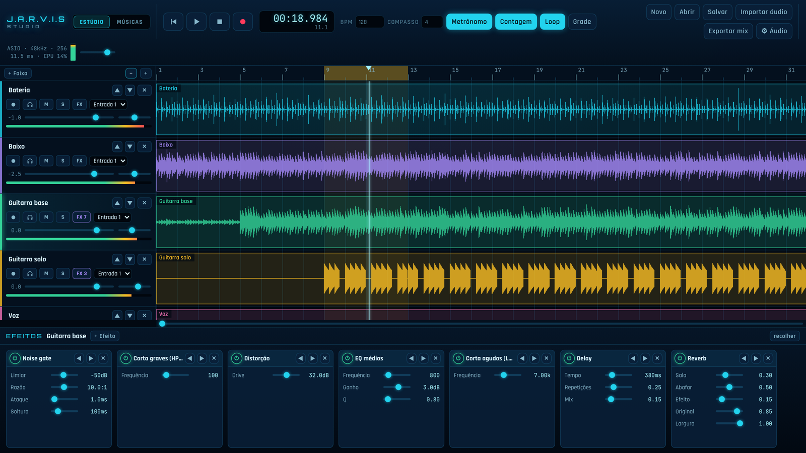
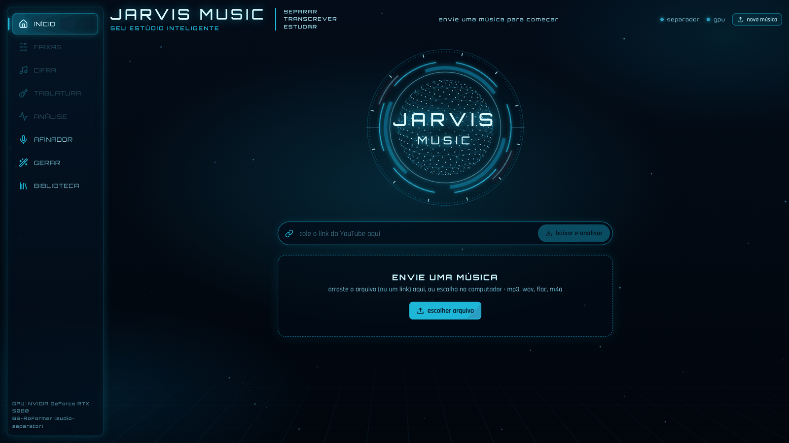
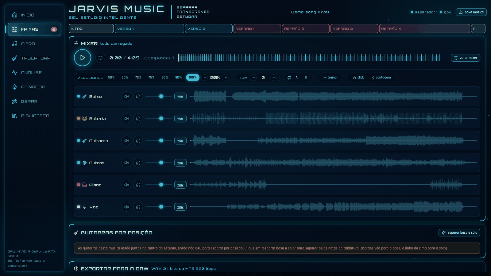
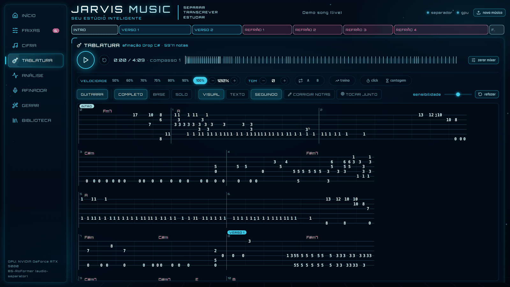
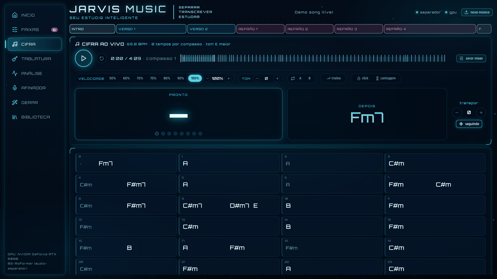
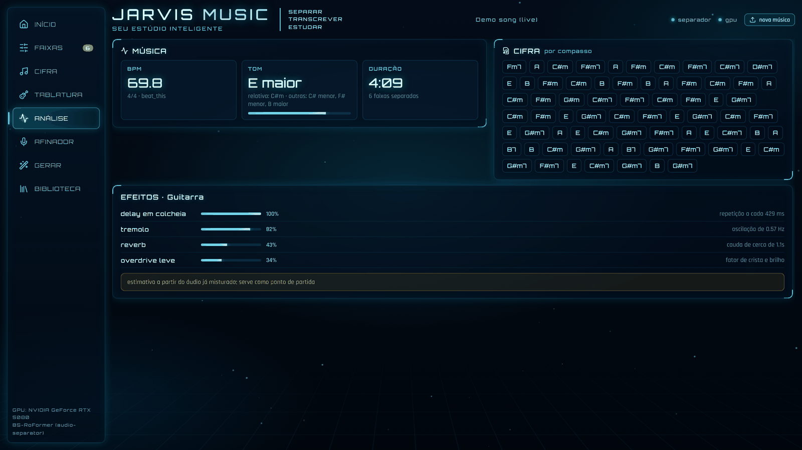
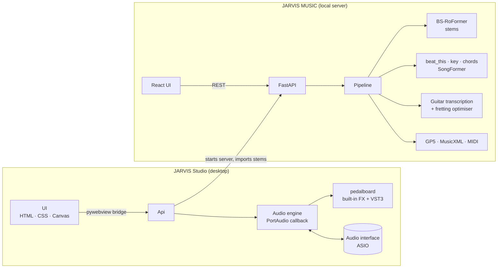

<div align="center">

# J.A.R.V.I.S &nbsp;STUDIO

### A local, AI‑powered music workstation for guitarists

Record with real‑time effects. Split any song into stems. Get its BPM, key, chords, sections and guitar tablature.<br/>
Then drop the stems straight into your own multitrack session and play along.

<br/>


<br/>



<sub>JARVIS Studio: multitrack timeline, loop region, per‑track effect chains and the ASIO engine status (sample rate, buffer, latency, CPU).</sub>

</div>

---

## Overview

This repository holds two applications that work as one:

| | What it is | Runs on |
|---|---|---|
| **[JARVIS Studio](jarvis-studio/)** | A desktop recording studio in the spirit of Reaper. Records tracks, monitors your guitar through live effects and VST3 plugins, saves projects and exports mixes. | Python audio engine + native window (pywebview) |
| **[JARVIS MUSIC](jarvis-music/)** | An AI analysis lab. Splits any song into 6 stems and extracts tempo, key, chords, song sections, guitar effects and a playable tablature. | FastAPI + PyTorch backend, React frontend |

JARVIS Studio starts JARVIS MUSIC in the background and shows it in its **Songs** tab. Pick an analysed song, click **Open in studio**, and every separated instrument becomes a track in your session, with the detected BPM, playing through your audio interface with effects. An armed empty track is left at the bottom so you can record your own guitar on top.

Everything runs **100% locally**. No song ever leaves your machine.

---

## Highlights

### 🎛️ JARVIS Studio: the recording side

- **Low‑latency audio engine** written in Python on top of PortAudio, talking to the sound card directly through **ASIO** (or exclusive WASAPI). The UI never touches audio: one single real‑time callback plays every track, runs each effect chain, monitors the armed input, records and mixes in the metronome.
- **Automatic latency compensation**: recordings are re‑aligned with the interface's reported round‑trip latency, with a manual fine‑tune for the last few samples.
- **16 built‑in effects** (noise gate, HPF/LPF, 3‑band EQ, compressor, distortion, clipping, bitcrush, chorus, phaser, delay, reverb, gain, limiter) plus **ready‑made chains** for clean guitar, distorted guitar, vocals and bass.
- **VST3 plugin hosting**, including each plugin's own editor window.
- **Non‑destructive workflow**: takes are recorded dry and effects are applied on playback, so the tone can be changed after recording.
- Timeline with waveform zoom and scroll, loop region, snap‑to‑beat, count‑in, metronome, mute / solo / pan / volume per track.
- Projects saved as a plain folder (`projeto.json` + one WAV per track) and **24‑bit mix export** rendered offline with every effect.

### 🧠 JARVIS MUSIC: the analysis side

| Task | How it's done |
|---|---|
| **Stem separation** | **BS‑RoFormer SW**, 6 stems (vocals, guitar, bass, drums, piano, other). #1 on the MVSEP guitar leaderboard. Falls back to Demucs `htdemucs_6s`. |
| **Rhythm & guitar vs. lead** | Stereo‑panorama split (L / C / R guitars) plus a note‑level classifier: chords and sustained voicings go to *rhythm*, single‑note lines with bends go to *lead*. |
| **Tempo & downbeats** | `beat_this` (state of the art in beat tracking), librosa fallback. |
| **Key & chords** | Key profiles over the chromagram, with confidence and alternatives. Chord sheet aligned to the **real bars** of the song. |
| **Song structure** | **SongFormer** (2025) for intro / verse / chorus / bridge, with a self‑similarity heuristic fallback. |
| **Tablature** | High‑resolution guitar transcription (Riley et al.) or Basic Pitch → a dynamic‑programming *playability optimiser* that picks string and fret with the least hand movement → bend, slide, vibrato and hammer‑on / pull‑off detection from the pitch curve. |
| **Tuning detection** | Compared against 8 tunings (E standard, Eb, D, Drop D, Drop C, Drop C#, C#, Drop B). |
| **Effects detection** | Audio measurements (saturation, reverb tail, delay time relative to BPM, modulation) with optional SFXlearner classifier. |
| **Export** | Guitar Pro (`.gp5`), MusicXML and MIDI with real time signatures and chord names; stems and mix as WAV 24‑bit or MP3 320 kbps. |

Built for practice, too:

- **Mixer** with solo / mute per stem, A‑B loop, **speed and pitch changed independently** (Signalsmith Stretch, ~60× real‑time, attacks aligned within 10 ms).
- **Live chord sheet and live tab** that follow the playhead bar by bar, with transpose.
- **Play‑along mode** that listens to your guitar through the audio input (YIN pitch detection + chroma for chords), checks it against the tab and scores every bar.
- **Progressive speed trainer**, a built‑in **tuner**, a note editor to fix the transcription, and a **library** of every song already analysed.
- Paste a **YouTube link** instead of a file.
- **GPU etiquette**: one model at a time, low process priority on CPU and GPU scheduler, and a VRAM cap, so the PC stays responsive while models run.

---

## Screenshots

<table>
  <tr>
    <td width="50%"><br/><sub><b>Home.</b> Drop a file or paste a link to start an analysis.</sub></td>
    <td width="50%"><br/><sub><b>Stem mixer.</b> Six separated instruments, song sections, speed and pitch control.</sub></td>
  </tr>
  <tr>
    <td width="50%"><br/><sub><b>Tablature.</b> 5,971 notes transcribed in Drop C#, with chords and sections on top.</sub></td>
    <td width="50%"><br/><sub><b>Live chords.</b> Current and next chord, bar grid, transpose.</sub></td>
  </tr>
  <tr>
    <td colspan="2"><br/><sub><b>Analysis.</b> Tempo, key with alternatives, chords per bar and the guitar's estimated effects.</sub></td>
  </tr>
</table>

> The interface is in Brazilian Portuguese. The studio screenshot shows a demo session with synthesized tracks; the JARVIS MUSIC screenshots show a real analysis of a live recording.

---

## Architecture



The studio's audio path is a single real‑time callback: for every block it reads each track, runs its `pedalboard` chain, applies volume and pan, adds the monitored input of the armed track, records the dry input and mixes the metronome. Heavy work (file I/O, rendering, plugin loading) never runs inside that callback.

---

## Getting started

> **Requirements:** Windows 10/11, Python 3.10+, an audio interface with an ASIO driver (or ASIO4ALL). For JARVIS MUSIC, an NVIDIA GPU is strongly recommended (CPU works, just slower) and Node.js 18+ to build the UI.

```bat
git clone https://github.com/lucaheset/jarvis-studio.git
cd jarvis-studio
```

**1. JARVIS MUSIC (analysis)**

```bat
cd jarvis-music
instalar.bat                       :: venv + PyTorch (CUDA 12.8) + all models' packages
cd web && npm ci && npm run build  :: builds the UI into backend\web
cd ..
iniciar.bat                        :: opens http://127.0.0.1:8770
```

The first analysis downloads the AI models once; after that everything works offline.

**2. JARVIS Studio (recording)**

```bat
cd ..\jarvis-studio
instalar.bat     :: venv + dependencies + desktop shortcut (no CUDA needed)
iniciar.bat
```

On first launch choose *Driver = ASIO*, your interface, 48 kHz and a 256‑sample buffer. Close other apps that hold the ASIO driver (most drivers accept one program at a time). Because both folders sit side by side, the Studio finds JARVIS MUSIC automatically.

Detailed guides: [JARVIS Studio](jarvis-studio/README.md) · [JARVIS MUSIC](jarvis-music/README.md) · [research notes](docs/RESEARCH.md)

---

## Tech stack

| Area | Tools |
|---|---|
| Real‑time audio | `sounddevice` (PortAudio with ASIO), `pedalboard`, NumPy, `soxr` |
| Desktop shell | `pywebview` (Edge WebView2), vanilla JS + Canvas |
| ML / DSP | PyTorch, `audio-separator` (BS‑RoFormer), Demucs, `beat_this`, Basic Pitch (ONNX), high‑res guitar transcription, SongFormer, librosa, scikit‑learn |
| Backend | FastAPI, Uvicorn, `yt-dlp`, ffmpeg, Signalsmith Stretch |
| Export | PyGuitarPro, MusicXML, `pretty_midi` / `mido` |
| Frontend | React 19, Vite, `react-icons` |

---

## Repository layout

```
jarvis-studio/            desktop recording studio
  app.py                  opens the window
  estudio/motor.py        audio engine: play, record, monitor, metronome
  estudio/efeitos.py      effect catalogue, presets, VST3 hosting
  estudio/projeto.py      save, open and export projects
  estudio/api.py          bridge between UI and engine
  estudio/musica.py       starts JARVIS MUSIC and pulls its stems
  ui/                     the interface (HTML, CSS, JS, no build step)

jarvis-music/             AI analysis lab
  backend/servidor.py     REST API and static UI
  backend/jarvis_music/   separation, analysis, tablature, sections, export, GPU queue
  web/                    React + Vite interface

docs/                     research notes and screenshots
```

---

## Honest limits

Automatic music transcription is still an open research problem, and the app says so in its own UI:

- **Stem separation** is the most mature part and works well.
- **BPM and key** are right on most songs with a clear pulse.
- **Tablature** is the weakest link for everyone: the best published end‑to‑end system in 2026 gets roughly half the notes right. That is why every tab can be edited in the app and exported to Guitar Pro / MuseScore to be finished by ear.
- **Rhythm vs. lead** and **effects detection** are informed estimates, not ground truth.

---

<div align="center">
<sub>Made by <a href="https://github.com/lucaheset">@lucaheset</a> · built for practising, recording and learning songs faster.</sub>
</div>
